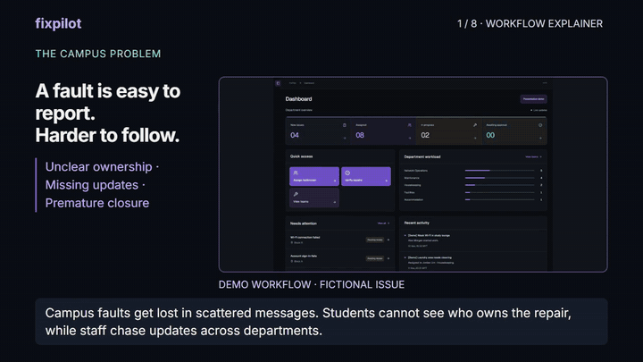
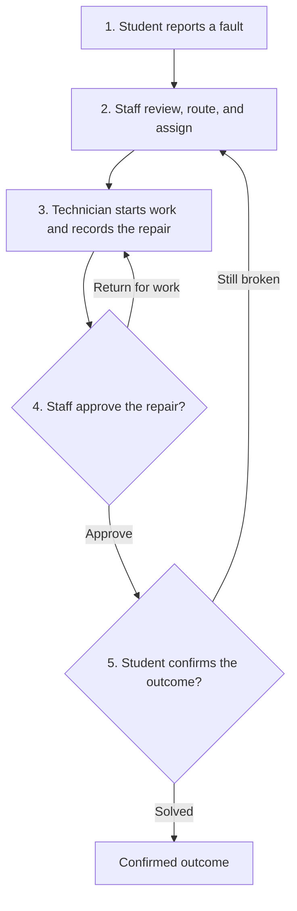
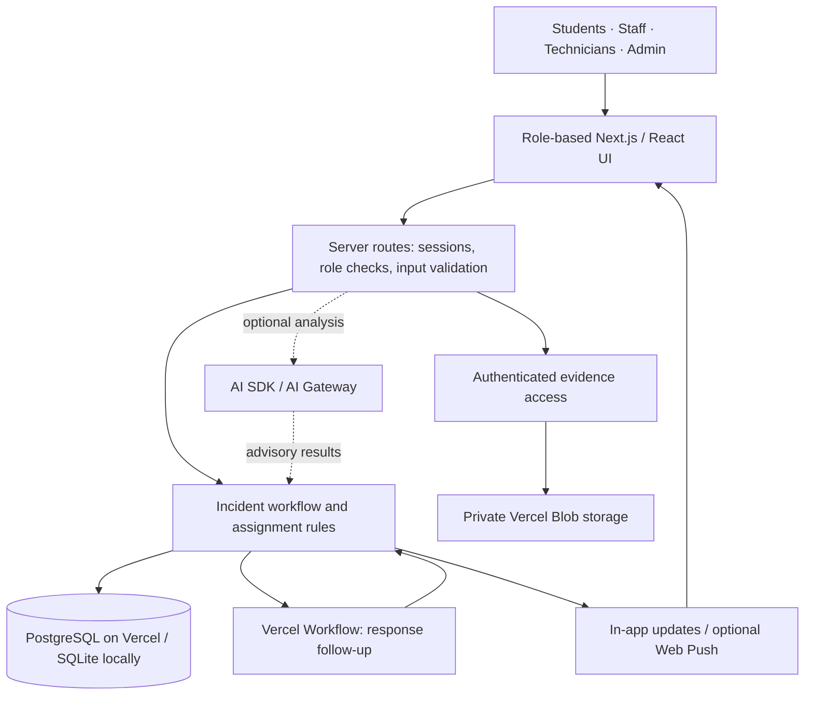

# FixPilot

**From a campus fault to an accountable resolution.**

FixPilot connects students, department staff, technicians, and administrators in one issue-reporting workflow—so every report has an owner, a visible history, and a student-confirmed outcome.

**[Try the live demo](https://fixpilot-public-demo.vercel.app/operations)** · **[Watch the narrated workflow](https://github.com/shayan-tkhan/FixPilot/blob/main/docs/media/fixpilot-demo.mp4)** · [Captions](docs/media/fixpilot-demo.srt)

*Next.js 16 · React 19 · TypeScript · Vercel*

## See it in action

[](https://github.com/shayan-tkhan/FixPilot/blob/main/docs/media/fixpilot-demo.mp4)

**20-second silent, looping preview.** Click it for the full 74-second explainer with narration and captions. The recording uses a fictional issue in an isolated local demo; no physical repair is claimed.

## The problem we address

| Campus reporting problem | FixPilot's response |
| --- | --- |
| Reports get scattered across messages | One report with location, description, attachments, and a timeline |
| Students do not know who owns the fix | Department and named-technician assignments |
| Tasks sit without an acknowledgement | Response countdowns, a 24-hour reminder, and a 48-hour reassignment check |
| A repair is marked complete too early | Separate staff approval, followed by student confirmation or reopening |
| Staff lack a location-level overview | APU campus/residence maps and monthly reporting views |

These are the problems the prototype is designed to address. We do not claim measured time savings or a campus production rollout.

## The workflow



- **Students:** submit and track their own reports, add evidence, confirm a repair, or reopen it.
- **Department staff:** review, assign or transfer, link duplicates, inspect repairs, and remove invalid issues.
- **Technicians:** see assigned tasks, acknowledge work, post progress, and submit repair evidence or a completion note.
- **Administrators:** view the campus-wide queue and coordinate the same review workflow.

### What makes the workflow accountable

**A technician cannot approve their own repair.** Completing work sends it for staff review; the student then checks the outcome.

**Similarity is a suggestion, not an automatic merge.** Reporters choose whether to join a matching issue; staff can explicitly merge duplicates.

**AI advises; the application controls changes.** Suggestions are checked, uncertain cases stay in staff review, and unavailable AI does not block manual reporting.

## Architecture



| Layer | Responsibility |
| --- | --- |
| Interface | Role dashboards, issue timelines, maps, monthly statistics, mobile reporting |
| Server | Session and role enforcement, validated mutations, report/evidence access |
| Workflow | Routing, technician eligibility, duplicate linking, review and confirmation |
| Persistence | Shared PostgreSQL state on Vercel; SQLite for local development |
| Follow-up | Token-scoped assignment timers; reminders and reassignment checks |
| AI, when available | Intake suggestions and description/media comparisons supporting human review |

Maps locate named sites, rather than claiming precise room coordinates or surveyed hostel floor plans. Uploads, analysis results, and approval are distinct records and decisions.

## Try the demo in three minutes

1. **Open the guided walkthrough** from any role dashboard to follow all six handoffs without changing saved reports.
2. **Explore the staff view:** inspect the issue queue, department teams, campus map, and monthly overview.
3. **Switch roles:** view a technician's assigned work and the student's report/confirmation experience.

Select a role on the sign-in page, or expand **More demo accounts**. All **17 demo accounts** autofill their credentials.

| Role | Account |
| --- | --- |
| Student | `reporter@fixpilot.demo` |
| Department staff | `reviewer@fixpilot.demo` |
| Technician | `operator@fixpilot.demo` |
| Administrator | `admin@fixpilot.demo` |

Disposable demo password: **`demo123`**. Profiles and sample reports are fictional. The directory includes twelve technicians across their departments.

### Demo data and AI status

- **Presentation mode:** a separate, read-only dataset with 150 fictional incidents—40 active, 92 resolved, and 18 confirmed. Eight critical incidents are included in the active count.
- **Guided walkthrough:** scripted, free to run, and separate from saved reports.
- **Live AI:** currently requires Vercel account verification. Manual reporting, staff assignment, and the guided workflow remain available.
- **Evidence review:** visual comparisons support staff judgment; they do not prove when media was recorded or guarantee that a hidden fault is fixed.

University SSO, managed real-user memberships, and a campus production rollout are future work. Email/SMS are not connected; Web Push is optional and browser-dependent.

## Run locally

Requires **Node.js 24**. From the project directory in PowerShell:

```powershell
npm ci
Copy-Item .env.example .env.local
# Set SESSION_SECRET in .env.local to a random value of at least 32 characters.
npm run seed
npm run dev
```

Open `http://localhost:3000`. Local development uses SQLite. Keep environment secrets and database files out of Git.

```powershell
npm test
npm run build
```

## Validation and source guide

Last recorded application verification: **83 automated tests passed**, with a passing production TypeScript/Next.js build and targeted role/mobile browser checks. These results are documented rather than presented as a full production certification.

- [Release checks](docs/release-checks.md) · [Validation notes](docs/validation.md)
- [Workflow transcript](docs/media/workflow-transcript.md) · [Demo script](docs/demo-script.md)
- `app/` — interface and server routes
- `lib/incidents/` — reporting, assignments, duplicate handling, and review rules
- `lib/ai/` — advisory intake and evidence comparison
- `lib/db/` — local/shared persistence
- `workflows/` — durable assignment follow-up
- `tests/` — workflow, authorization, evidence, and routing checks

## Video credits

Narration: local Kokoro Heart voice. Music: [Sascha Ende, ende.app](https://ende.app/en), [CC BY 4.0](https://creativecommons.org/licenses/by/4.0/). The video uses fictional demo data; no live AI verification or physical repair is claimed.
